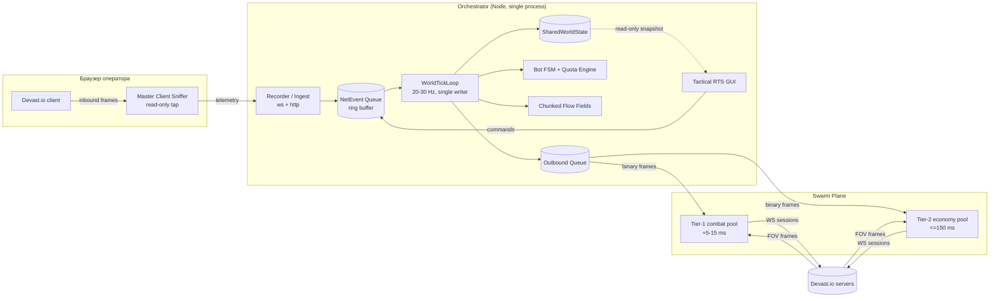
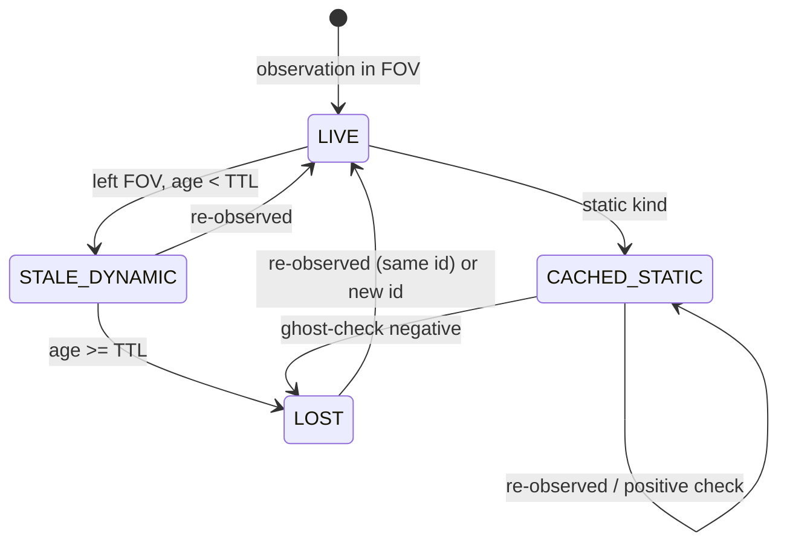

# Architecture v2 — Devast.io Swarm RTS Orchestrator

| Поле | Значение |
|---|---|
| Версия | 2.0 |
| Статус | Design freeze for Phase 0; Phase 1+ — draft |
| Источник требований | `docs/brief/Технический бриф и архитектура_ RTS Swarm Orchestrator для Devast.io.docx` |
| Область | Headless-рой 10–100+ сессий, тактическая карта, квоты, бой |
| Не область | Замена клиента Devast.io, рендер игры, автопрокачка аккаунта оператора |

Документ фиксирует восемь решений, принятых после ревью брифа. Решения оформлены как ADR с последствиями; всё, что не следует из них явно, помечено как **калибруемый параметр** и не считается истиной о сервере игры.

---

## 0. Инварианты (нарушение = баг архитектуры, не «особенность»)

| ID | Инвариант |
|---|---|
| I1 | `SharedWorldState` мутирует **только** `WorldTickLoop` в одном потоке. Сетевые колбэки и GUI-хендлеры кладут события в очередь и ничего не читают из mutable-состояния. |
| I2 | `Master Client` оператора — **read-only tap**. Ни один пакет оркестратора не уходит в его игровой сокет. |
| I3 | Ни один опкод, смещение или тип поля не хардкодится в бизнес-логике. Всё приходит из `config/protocol-schema.json`; неизвестный опкод — штатное событие `UnknownFrame`, а не исключение. |
| I4 | Динамическая сущность без подтверждения из FOV живёт не дольше `dynamicTtlMs` (10–15 с), затем `LOST`. Статическая сущность не удаляется по времени — только `ghost-check`. |
| I5 | Резервирование ресурсной ноды атомарно в рамках тика: одна нода — максимум один `botId`. |
| I6 | Friendly-fire проверка выполняется до постановки пакета атаки в outbound-очередь и повторно — на момент попадания (цель могла сместиться). |
| I7 | Исходящий пакет формируется только из состояния, зафиксированного в текущем тике. Никаких «дострелов» из колбэков сокета. |
| I8 | Бюджет тика жёсткий. При перерасходе деградируют **небоевые** подсистемы в фиксированном порядке (§9.4), а не частота тика. |
| I9 | Любой кадр дампа воспроизводим из `fixtures/`: `(schemaVersion, gameBuild, bytes)` → детерминированный `DecodeResult`. |
| I10 | Дампы сессий — локальные данные. Они могут содержать ники, клан-теги, IP-эндпоинты; в репозиторий попадают только обезличенные фикстуры. |
| I11 | Все задержки измеряются в миллисекундах и хранятся как `number`; конвертация в секунды — только на границе математики. |
| I12 | Никакой «магической синхронизации»: jitter и шум — параметры конфигурации с распределением и seed, а не случайные вызовы в глубине кода. |

---

## 1. Контекст и ограничения

Из брифа и ревью:

1. **FOV culling.** Сервер отдаёт клиенту только объекты в его области видимости. «Глобальная карта» невозможна; возможна карта **наблюдений** с разной степенью достоверности.
2. **Лимит сессий на IP.** До 6 WS-подключений с одного адреса. 100 ботов требуют ≥17 egress-адресов.
3. **Обфускация и бинарная сериализация.** Формат пакетов неизвестен на старте. Реверс — блокирующая работа, а не «этап полировки».
4. **Сетевой бюджет боя.** Aimbot и focus fire чувствительны к RTT; резидентные прокси +200 мс непригодны для боевых юнитов.
5. **Выживание.** Голод, холод, радиация убивают за минуты; автономность обязательна.
6. **Принятый риск.** Массовые боты и обход IP-лимитов нарушают правила игры; возможен бан аккаунтов. Компенсации — §13, отказ от риска не является архитектурным решением.

---

## 2. Обзор системы

Пять плоскостей, два исполняемых контура (браузер оператора и Node-оркестратор), одна локальная шина `ws://127.0.0.1`.



Ключевые потоки:

- **Capture plane** (Phase 0): sniffer → recorder → `protocol-schema.json` + fixtures. Работает без отправки игровых пакетов.
- **World plane**: `NetEvent` → tick → immutable snapshot → FSM/quota/navigation → outbound intent.
- **Control plane**: GUI читает снапшот, пишет команды в ту же очередь (с `source: 'operator'`), не трогая state напрямую.

---

## 3. ADR-001. Протокол как данные: `ProtocolRecorder` и schema-first

**Решение.** Любой разбор пакета идёт через версионируемую схему `config/protocol-schema.json`. Код не содержит числовых опкодов и смещений. Сбор данных — `ProtocolRecorder`: Tampermonkey-сниффер в окне оператора + локальный приёмник.

### 3.1. Формат схемы

```ts
// src/protocol/types.ts (фрагмент)
export type Direction = "c2s" | "s2c";
export type FieldType =
  | "u8" | "i8"
  | "u16le" | "u16be" | "i16le" | "i16be"
  | "u32le" | "u32be" | "i32le" | "i32be"
  | "f32le" | "f32be" | "f64le" | "f64be"
  | "varint" | "string" | "bytes";

export interface FieldSpec {
  name: string;
  /** Абсолютное смещение от начала кадра. Если не задано — читается последовательно. */
  offset?: number;
  type: FieldType;
  /** Для string: префикс длины. Для bytes: фиксированная длина. */
  length?: number;
  lengthType?: "u8" | "u16le" | "u16be" | "varint";
  count?: number;
  /** Масштаб/смещение для fixed-point полей (значение = raw * scale + bias). */
  scale?: number;
  bias?: number;
  note?: string;
}

export interface OpcodeSpec {
  name: string;
  direction: Direction;
  /** confirmed — проверено на нескольких сессиях; hypothesis — кандидат; unknown — только сигнатура. */
  status: "confirmed" | "hypothesis" | "unknown";
  opcode: { offset: number; type: "u8" | "u16le" | "u16be" | "varint" };
  /** Префикс длины кадра, если фрейминг не по границе WS-сообщения. */
  lengthPrefix?: { offset: number; type: "u8" | "u16le" | "u16be" | "varint"; includesHeader: boolean };
  fields: FieldSpec[];
  notes?: string;
}

export interface ProtocolSchema {
  schemaVersion: number;
  game: "devast.io";
  gameBuild: string;
  capturedAt: string;
  authoritative: boolean;
  framing: {
    mode: "ws-message" | "length-prefixed" | "unknown";
    notes?: string;
  };
  opcodes: Record<Direction, Record<string, OpcodeSpec>>;
  unknownOpcodes: Array<{ direction: Direction; opcode: number; firstSeenAt: string; sampleHex: string }>;
}
```

Правила:

1. `authoritative: false` для схемы, собранной по гипотезам; парсер всё равно работает, но CI не валит сборку на unknown.
2. Новый опкод добавляется только с примером кадра в фикстуре. «Название по догадке» запрещено: `status: "hypothesis"`, `name: "unknown_0x2a"`, пока не подтверждено поведением.
3. При обновлении игры меняется `gameBuild`, а не только `schemaVersion`. Оба поля попадают в каждую запись фикстуры.

### 3.1a. Текстовые JSON-кадры

Часть серверных сообщений приходит не бинарём, а WebSocket-text с JSON-массивом, где опкод лежит в индексе 0. Это отдельный формат: его нельзя описывать байтовыми смещениями. В схеме для него есть независимая секция `textOpcodes`:

```ts
export interface TextFieldSpec {
  name: string;
  index: number;              // индекс в JSON-массиве, 0 — опкод
  type: "number" | "string" | "nullable" | "boolean" | "array" | "any";
}

export interface TextOpcodeSpec {
  name: string;
  direction: Direction;
  status: OpcodeStatus;
  opcode: number;             // значение в индексе 0
  fields: TextFieldSpec[];
  rest?: boolean;             // сохранить остаток массива как fields.rest
}
```

Первый реальный захват 2026-11-11 (`wss://frankfurt4.devast.io/frankfurtsurvival1`) дал текстовые опкоды `2` (roster), `5` (server tags), `6` (pair), `7` (id list), `8` (id/name/value), `9` (leaderboard). Все они зафиксированы со `status: "hypothesis"`: структура массива подтверждена, семантика полей — нет. Бинарные кадры того же соединения (22-байтовые `0x14…`, 92-байтовый `0x47…` handshake) остаются неразобранными.

### 3.2. Декодер

```ts
export type DecodeResult =
  | {
      ok: true;
      direction: Direction;
      opcode: number;
      name: string;
      status: OpcodeSpec["status"];
      fields: Readonly<Record<string, unknown>>;
      consumedBytes: number;
    }
  | {
      ok: false;
      direction: Direction;
      reason: "unknown-opcode" | "truncated" | "out-of-bounds" | "bad-length-prefix" | "invalid-value";
      opcode: number | null;
      offset: number;
      detail: string;
      sampleHex: string;
    };
```

Требования к декодеру:

- Чтение за границей буфера → `out-of-bounds` с точным смещением, без исключения.
- `DataView` создаётся с `byteOffset/byteLength` исходного `Uint8Array`; запрещено делать `new DataView(u8.buffer)` без учёта view.
- Строки — UTF-8, `TextDecoder("utf-8", { fatal: false })`; длина проверяется до декодирования.
- `varint` — LEB128 без знака, максимум 5 байт, иначе `invalid-value`.
- Результат детерминирован: одинаковые байты + схема → одинаковый JSON (порядок полей — порядок схемы).

### 3.3. `NetEvent` и граница процессов

```ts
export interface NetEvent {
  readonly seq: number;
  readonly sessionId: string;
  readonly direction: Direction;
  readonly kind: "binary" | "text";
  /** Монотонные часы агента (performance.now), не epoch. */
  readonly agentTs: number;
  /** Часы оркестратора в момент приёма; единственные, по которым живёт тик. */
  readonly recvTs: number;
  readonly socketId: string;
  readonly payload: Uint8Array;
  readonly meta?: Readonly<Record<string, string | number | boolean>>;
}
```

`agentTs` и `recvTs` не смешиваются: первый годится только для оценки задержки доставки и корреляции с действиями внутри браузера, второй — для TTL и планирования.

### 3.4. Фикстуры

Каталог `fixtures/<name>/`:

```json
// meta.json
{
  "name": "synthetic-basic",
  "gameBuild": "synthetic",
  "schema": "../../config/protocol-schema.synthetic.json",
  "frames": "frames.jsonl",
  "expected": "expected.json",
  "strict": true
}
```

`frames.jsonl` — по строке на кадр: `{"dir":"c2s","hex":"0100000000","note":"ping"}`. `expected.json` — массив `DecodeResult` (или `fields`-снапшот). Проверка: `npm run fixtures:check`; обновление снапшота — `--update` только после ручного подтверждения, что изменение схемы ожидаемо. Это защита от «парсер стал другим, но тест зелёный».

Анализатор сессии (`tools/recorder/analyze.mjs`) выдаёт кандидатов и корреляцию действий. Флаг `--emit-schema` создаёт `protocol-schema.draft.json` с `status: "hypothesis"` и пустыми полями: это стартовая таблица опкодов, а не готовая схема. Перенос в `config/protocol-schema.json` — ручной шаг после подтверждения полей.

---

## 4. ADR-003. Tiered Proxy Pool

**Решение.** Два пула с разными SLA.

| Параметр | Tier-1 Combat | Tier-2 Economy |
|---|---|---|
| Egress | datacenter IPv4/IPv6 подсети, WireGuard/SOCKS5 в регионе сервера | дешёвые резидентные/облачные прокси |
| Added latency (p95) | +5–15 мс | ≤150 мс |
| Назначение | преследование, focus fire, aimbot, охрана | добыча, плавка, логистика, разведка |
| Плотность | ≤5 сессий на IP (лимит 6, запас 1) | ≤5 сессий на IP |
| Реконнект | агрессивный, с сохранением роли | терпимый, батчевый |
| Стоимость | выше | ниже |

Правила распределения:

1. `BotRole` детерминированно маппится на `NetworkTier`. Смена роли в бою не переключает egress на лету: сессия переподключается только по явному приказу (иначе теряется позиция и инвентарь).
2. Пул ведёт учёт `activeSessionsByEgressIp`; при достижении 5 новые сессии ждут или распределяются на другой адрес.
3. Health-check: TCP/TLS handshake + игровой handshake, p50/p95 RTT, jitter, loss. Нода с p95 > порога для своего tier выводится из ротации.
4. Tier-1 не используется для 100% роя: экономика на дорогих каналах убыточна. Целевое соотношение задаётся конфигом (например, 20–30% боевых).
5. Задержка **измеряется на уровне игрового сокета**, а не ICMP: RTT handshake/эхо-пакета, медиана по 30 замерам.

Ограничение: прокси не отменяет серверные эвристики. Jitter (§14) — вероятностная митигация, а не гарантия.

---

## 5. ADR-002. Epistemic World State

**Решение.** Вместо `Map<EntityId, Entity>` — модель наблюдений с уровнями достоверности.

### 5.1. Типы

```ts
export type EntityId = number;
export type AgentId = string;
export type BotId = string;
export type TimestampMs = number;

export interface Vec2 {
  x: number;
  z: number;
}

export type ConfidenceLevel = "LIVE" | "STALE_DYNAMIC" | "CACHED_STATIC" | "LOST";

export interface EntityConfidence {
  level: ConfidenceLevel;
  /** 1.0 — подтверждено текущим FOV; для STALE убывает линейно до 0 на горизонте TTL. */
  score: number;
  lastSeenTs: TimestampMs;
  lastSeenBy: AgentId | null;
  /** now - lastSeenTs на момент снапшота. */
  stalenessMs: number;
  /** Радиус bounding-области неопределённости, мировые единицы. */
  uncertaintyRadius: number;
  /** Для dynamic — момент перехода в LOST; для static — null (только ghost-check). */
  expiresAtTs: TimestampMs | null;
}

export interface ObservationSource {
  agentId: AgentId;
  frameSeq: number;
  observedAt: TimestampMs;
  /** Оценка FOV-покрытия агентом точки на момент наблюдения. */
  coverage: "direct" | "shared" | "inferred";
}

export interface DynamicEntity {
  readonly id: EntityId;
  readonly kind: "player" | "mob" | "projectile" | "dropped-item";
  name?: string;
  clanTag?: string;
  pos: Vec2;
  vel: Vec2;
  hp?: number;
  equipped?: string;
  confidence: EntityConfidence;
  observers: ReadonlySet<AgentId>;
  /** Оценка серверного времени наблюдения (recvTs - oneWayLatency). */
  serverTsEstimate: TimestampMs;
}

export type StaticKind =
  | "wall" | "floor" | "door" | "spike"
  | "smelter" | "workbench" | "generator" | "storage"
  | "turret" | "robot" | "tesla" | "computer"
  | "campfire" | "other";

export interface StaticEntity {
  readonly id: EntityId;
  readonly kind: StaticKind;
  pos: Vec2;
  /** Для стен/баз — прямоугольник; для точечных объектов — undefined. */
  bounds?: { min: Vec2; max: Vec2 };
  owner?: { name?: string; clanTag?: string };
  hp?: number;
  confidence: EntityConfidence;
  /** История ghost-check: кто и когда покрывал координату без подтверждения. */
  ghostChecks: ReadonlyArray<{ agentId: AgentId; checkedAt: TimestampMs; covered: boolean; confirmed: boolean }>;
  firstSeenTs: TimestampMs;
  lastConfirmedTs: TimestampMs;
}

export type WorldEntity = DynamicEntity | StaticEntity;

export interface SharedWorldState {
  readonly tick: number;
  readonly snapshotTs: TimestampMs;
  readonly entities: ReadonlyMap<EntityId, WorldEntity>;
  readonly iff: IffRegistry;
  readonly quotas: ReadonlyMap<QuotaId, TaskQuota>;
  readonly bots: ReadonlyMap<BotId, BotRuntimeView>;
  readonly gridVersion: number;
  readonly stats: {
    live: number;
    stale: number;
    cachedStatic: number;
    lost: number;
    unknownFrames: number;
  };
}

export interface WorldWriter {
  /** Единственный мутатор; вызывается только из WorldTickLoop. */
  apply(event: NetEvent | OperatorCommand, now: TimestampMs): void;
  advance(now: TimestampMs): void;
  snapshot(): SharedWorldState;
}
```

### 5.2. Переходы



Правила:

1. **LIVE** ставится, если сущность пришла в кадре FOV любого агента. `score = 1.0`, `uncertaintyRadius = hitboxRadius` (обычно 0.5–1 тайл).
2. **STALE_DYNAMIC**: `staleness = now - lastSeenTs`; `score = max(0, 1 - staleness / dynamicTtlMs)`; `uncertaintyRadius = r0 + |v| * staleness/1000 + driftSigma`. `r0` — хитбокс, `driftSigma` — консервативный запас на смену направления (калибруется, старт 1.5 тайла). Экстраполяция позиции — `lastPos + lastVelocity * staleness/1000`, но **для планирования используется bounding circle**, а не точка: FSM обязан проверять целей по `uncertaintyRadius`.
3. `dynamicTtlMs ∈ [10_000, 15_000]`, конфиг. Для мобов допускается меньший TTL (они быстрее «теряются»), для игроков — верхняя граница.
4. **CACHED_STATIC** не истекает по времени. `expiresAtTs = null`. Хранится до `ghost-check`.
5. **Ghost-check.** Агент `A` находится в точке, чей FOV покрывает `pos` статической сущности `S` дольше `ghostGraceMs` (2 серверных тика + 500 мс буфер), но сервер не прислал `S.id` ни в одном кадре за это окно. Тогда `S` помечается `LOST` и удаляется из планирования рейдов; в GUI остаётся серым «предположительно уничтожен». Один негативный чек не удаляет запись окончательно — нужен `ghostConfirmations ≥ 2` от разных агентов **или** физическое покрытие координаты одним агентом в течение окна. Это защита от «сервер не прислал из-за LOD/стриминга».
6. `FOV coverage` — не круг: используется `fovRadius`, сектор обзора и LOS-проверка по статической геометрии. Достоверность покрытия помечается `direct`/`shared`/`inferred`; `inferred` не даёт ghost-check.
7. При повторном появлении сущности с тем же `id` после `LOST` — новая запись с `firstSeenTs`; старые наблюдения не воскрешаются.

### 5.3. Почему не «глобальная карта»

Слияние FOV даёт **объединение наблюдений**, а не состояние сервера. Любая логика, которая считает `STALE`-игрока «находящимся здесь», систематически ошибается. Поэтому API отдаёт `WorldEntity` с `confidence`, и FSM обязан явно выбрать политику: `allowStaleFor("travel")` — да, `allowStaleFor("aim")` — нет (только `LIVE` + ≤300 мс).

---

## 6. ADR-007. Single-Writer Actor Model

**Решение.** Один поток, одна очередь, один writer.

```
WS parser threads/events ──► NetEvent (immutable) ──► RingBuffer
                                                       │
GUI commands ─────────────────────────────────────────┤
                                                       ▼
                                    WorldTickLoop (20–30 Hz, один поток)
                                    1. drain(cap)
                                    2. validate + dedupe
                                    3. world.apply
                                    4. world.advance (TTL, ghost-check)
                                    5. quotaEngine.tick
                                    6. botFsm.tick (budgeted)
                                    7. navigation.tick (budgeted)
                                    8. outbound.flush
                                    9. metrics + snapshot publish
```

### 6.1. Очередь

```ts
export interface EnqueueResult {
  accepted: boolean;
  reason?: "queue-full" | "invalid" | "duplicate";
  depth: number;
}

export class NetEventRing {
  constructor(capacity: number); // старт 8192
  push(event: NetEvent): EnqueueResult;
  drain(max: number): NetEvent[];
  readonly highWatermark: number; // 0.75 * capacity
  readonly lowWatermark: number;  // 0.40 * capacity
}
```

Политика backpressure:

- `structural` события (постройка/разрушение/смерть/инвентарь) никогда не дропаются: отдельный резерв ёмкости (25%).
- При переполнении дропаются самые старые `position`-события; счётчик `droppedPositional` растёт, в GUI показывается деградация.
- Дубликаты: `(socketId, seq)` — отбрасываются; `(direction, sha256(payload), window 50 мс)` — только для диагностики, не для мира (одинаковые пакеты могут быть легитимны).

### 6.2. Тик

- Частота: 20 Гц (50 мс) по умолчанию; 30 Гц — только для Tier-1 боевых групп, если бюджет позволяет.
- `maxTickMs = min(0.8 * tickInterval, 40)` — жёсткий предел.
- Внутри тика запрещены `await`, сетевые вызовы, чтение файлов и любые операции, чья длительность не ограничена.
- Отправка пакетов — не в колбэке сокета, а из `outbound.flush` в конце тика. Пакеты, сформированные в тике `N`, уходят одним батчем; порядок внутри бота сохраняется.
- Если тик опоздал (event loop lag > интервала), следующий тик не «догоняет» дважды: пропуск фиксируется, FSM получает `dt = фактическое время`, квоты не пересчитываются дважды.

### 6.3. Почему не actor-per-bot

100 ботов × отдельный поток/актор = 100 планировщиков, гонки за ноды и общую карту, недетерминизм. Для 100 сущностей один поток с бюджетом дешевле и проверяем. Actor-модель применяется только на уровне **сессий** (WS-пул), где изоляция оправдана.

---

## 7. ADR-004. Баллистический солвер

### 7.1. Постановка

Дано:

- `P` — позиция стрелка (центр хитбокса) в момент решения, мировые единицы;
- `T` — позиция цели на момент наблюдения, экстраполированная к `now`;
- `V` — вектор скорости цели, ед/с;
- `s` — скорость снаряда, ед/с;
- `rtt` — RTT сокета бота до сервера, мс;
- `jitter` — оценка дрожания серверного тика, мс (`serverTickMs / 2` как старт);
- `R = rtt/2000 + jitter/1000` — односторонняя задержка + тиковый запас, с.

Нужно найти время полёта `t_f` такое, что снаряд и цель встречаются:

```
| (T + V * (t_f + R)) - P | = s * t_f
```

### 7.2. Решение

Обозначим `A = T + V*R - P`. Тогда:

```
|A + V*t_f|² = s² * t_f²
(A·A) + 2*t_f*(A·V) + t_f²*(V·V) = s²*t_f²
(V·V - s²) * t_f² + 2*(A·V) * t_f + (A·A) = 0
```

Квадратное уравнение `a*t² + b*t + c = 0`:

```
a = V·V - s²
b = 2 * (A·V)
c = A·A
D = b² - 4*a*c
```

Корни:

```
если |a| > eps:  t = (-b ± sqrt(D)) / (2a)
если |a| <= eps: t = -c / b        (b < 0, иначе решения нет)
```

Выбор корня: **наименьший положительный** `t_f`. Отрицательный корень — цель «была бы поражена в прошлом», отбрасывается. Если положительных нет — перехват невозможен (цель быстрее снаряда и уходит).

Точка прицеливания:

```
impactPoint = T + V * (t_f + R)
aimVector   = normalize(impactPoint - P')
P'          = P + V_bot * R     (позиция стрелка на момент выстрела)
```

Солвер возвращает `shooterAtShot = P'`; вектор прицела строится от него, а не от текущей позиции `P`, иначе движущийся бот систематически недобирает упреждение.

Проверка корректности (обязательна в коде и тестах):

```
| |impactPoint - P| - s * t_f | <= 1e-6 * max(1, s * t_f)
```

### 7.3. Edge cases

| Случай | Поведение |
|---|---|
| `D < 0` | `feasible: false`, reason `no-positive-root`; FSM не стреляет, сближается |
| `D` чуть отрицателен из-за float (`> -1e-9`) | clamp до 0 |
| `a ≈ 0`, `b ≈ 0` | цель в точке стрелка или идентичные скорости: `t = 0`, стрелять в упор |
| `t_f` > `maxFlightTimeS` | `feasible: false`, reason `out-of-range` |
| `s <= 0` | ошибка конфигурации, не «нет решения» |
| Цель меняет направление | `uncertaintyRadius` из §5.2 добавляется к радиусу цели; если `radius > 0.5 * distance`, стрельба запрещена |
| Стрелок движется | в формулу подставляется позиция на момент выстрела с учётом собственной скорости: `P' = P + V_bot * R`; учитывается отдельно, чтобы не путать с упреждением |

### 7.4. `WEAPON_SWAP_PENDING`

Смена слота — не мгновенная операция: пакет уходит, сервер подтверждает инвентарь, только затем возможна атака.

```ts
export interface WeaponSwapState {
  phase: "idle" | "swap-requested" | "swap-confirmed" | "fire-window";
  requestedAtTs: TimestampMs;
  /** max(serverTickMs, rttMs) + safetyMarginMs */
  deadlineTs: TimestampMs;
  targetId: EntityId | null;
  /** Упреждающий угол, рассчитанный до подтверждения слота. */
  preAimPoint: Vec2 | null;
}
```

Правила:

1. FSM входит в `WEAPON_SWAP_PENDING` при появлении цели в радиусе боя, если экипирован инструмент.
2. Длительность ожидания: `max(serverTickMs, rttMs) + 1 тик`. Подтверждение приходит событием инвентаря; таймаут — предохранитель, а не штатный путь.
3. Пока слот не подтверждён, **пакет атаки не отправляется**. Разрешён только поворот/позиционирование; `preAimPoint` считается заранее по §7.2 с текущим RTT.
4. После подтверждения — переход в `fire-window` не дольше `fireWindowMs` (например, 150 мс), затем повторный расчёт упреждения (цель сместилась).
5. Если цель ушла из FOV/LIVE — своп отменяется, бот возвращается к инструменту только по приоритету выживания/квоты.

### 7.5. Focus fire

- Цель одна на группу; лидер группы — бот с наименьшим RTT и лучшим углом.
- Дуга: каждый бот получает смещение `offsetAngle` от линии на цель; шаг зависит от `2 * atan(hitboxRadius / distance)`.
- Линия огня: перед выстрелом проверяется сегмент `bot → impactPoint` на союзников (ADR-006). Если пересечение — бот не стреляет, выбирает следующую свободную точку дуги или ждёт окно.
- Не более `maxSimultaneousShots` на цель за тик (иначе избыточный урон и трата снарядов).

---

## 8. ADR-005. Chunked Dirty Flow Fields

**Решение.** Мир делится на чанки `32×32` тайла (конфиг; для больших карт — 64×64). Изменение проходимости помечает `dirty` только чанк и 8 соседей.

```ts
export interface ChunkKey {
  cx: number;
  cz: number;
}

export interface Chunk {
  key: ChunkKey;
  /** Битовая маска проходимости/стоимости, row-major. */
  cost: Uint8Array;
  /** Интегральное поле до цели; null — не рассчитано. */
  integration: Uint32Array | null;
  /** Вектор потока на тайл; null — не рассчитано. */
  flow: Int8Array | null;
  dirty: boolean;
  lastBuiltTick: number;
  /** Бюджет в тайлах, потраченный на последний пересчёт. */
  buildCost: number;
}

export interface NavigationConfig {
  chunkTiles: 32 | 64;
  maxChunkBuildsPerTick: number;
  maxTilesPerTick: number;
  /** Приоритет: чанки рядом с активными ботами и целями. */
  priorityRadiusTiles: number;
}
```

Алгоритм:

1. Событие `WallBuilt`/`WallDestroyed`/`StructureRemoved` меняет `cost` тайла и ставит `dirty` на чанк + соседей (граница могла изменить проходимость между чанками).
2. В тике выбираются не более `maxChunkBuildsPerTick` dirty-чанков по приоритету: близость к боевым ботам > близость к целям квот > остальные.
3. Интегральное поле строится локально от **порталов чанка** (граничных проходимых тайлов), а не от глобальной цели: сначала Dijkstra по графу порталов (маленький), затем локальный Dijkstra внутри чанка. Это и есть chunked/hierarchical flow field.
4. `flow` строится из интегрального поля только для тайлов, где он нужен (в радиусе активных ботов), лениво.
5. Изменение за пределами `priorityRadiusTiles` не пересчитывается до приближения бота; при входе в зону чанк получает высокий приоритет и пересчитывается в течение ≤2 тиков. До этого бот использует последний валидный flow и **не застревает**: при `flow == null` включается локальный A* по ограниченному окну (fallback).
6. Бюджет: `maxTilesPerTick` (старт 2000) и `maxChunkBuildsPerTick` (старт 2). При перерасходе — перенос на следующий тик, счётчик `deferredChunks`.
7. Инвалидация: `gridVersion++` при любом изменении; боты хранят `gridVersion`, с которым построен их путь, и перезапрашивают при расхождении.

Ограничение: одна глобальная цель на всех ботов не масштабируется. Flow field строится **на группу/цель**, кэшируется по `(targetCell, gridVersion)`; при 100 ботах и 5 целях — 5 полей, а не 100.

---

## 9. ADR-006. Friendly Fire за O(1): Spatial Hash Grid

**Решение.** Пространственный хэш с размером ячейки `cellSize = maxProjectileRange`.

```ts
export interface CircleBody {
  id: EntityId;
  pos: Vec2;
  radius: number;
  kind: "self" | "ally-bot" | "whitelist" | "blacklist" | "neutral";
}

export class SpatialHashGrid {
  constructor(cellSize: number);
  upsert(body: CircleBody): void;
  remove(id: EntityId): void;
  querySegment(a: Vec2, b: Vec2, padding: number): CircleBody[];
  firstHit(a: Vec2, b: Vec2, padding: number): CircleBody | null;
}
```

Проверка выстрела:

1. `a = botPos`, `b = impactPoint`; `padding = pingMargin + projectileRadius` (запас на рассинхрон, старт `speed * (rtt/2 + tick/2)`).
2. `querySegment` идёт по ячейкам, которые пересекает расширенный bbox сегмента (при `cellSize = maxRange` это 1–4 ячейки), и возвращает только `self | ally-bot | whitelist`.
3. Для каждого кандидата — segment-circle intersection: расстояние от центра до ближайшей точки отрезка ≤ `radius + padding`.
4. Если есть попадание — выстрел блокируется; `firstHit` даёт ближайшего, чтобы FSM выбрал объезд/смену дуги.
5. Проверка повторяется на момент попадания: позиции союзников экстраполируются на `t_f`, потому что союзник тоже движется.

Сложность: `O(cells + candidates)`; при плотности 100 сущностей на карте и ячейке в дальность выстрела кандидатов обычно 0–3. Худший случай (все в одной ячейке) деградирует, но остаётся линейным по локальной плотности; для 100 ботов это приемлемо. При росте до 1000 — субделение ячейки на квадранты.

Ограничение: 2D-геометрия не учитывает высоту и реальные hitbox'ы игры; параметры калибруются по фикстурам попаданий.

---

## 10. ADR-008. OpSec и изоляция оператора

**Решение.** Основной аккаунт не участвует в автоматизации.

- `Master Client Bridge` — **read-only tap**: перехват входящих WS-сообщений, отправка телеметрии на `127.0.0.1`. Исходящий трафик оператора не модифицируется: `send` вызывается с исходными аргументами, без подмены payload.
- Целеуказание (Blacklist/Whitelist) — локальный оверлей и отдельное окно GUI. В игровой сокет оператора команды не инжектятся.
- Сеть оператора отделена от egress-пулов роя. Никаких «проксировать оператора через Tier-1».
- Учётные данные, cookies, токены сессий не покидают процесс; дампы не содержат заголовков авторизации (WS-фреймы их и не содержат, но handshake-логи — да; логируем только URL без query).
- Принятый риск: массовые боты нарушают ToS; аккаунты роя и оператора могут быть забанены. Митигации: малые рои на старте (10–20), отдельные egress, отсутствие автоматизации на основном аккаунте, лимиты частоты действий. Гарантий нет; это фиксируется как риск продукта, а не скрывается.

---

## 11. ADR-005b. Квоты и атомарное резервирование

```ts
export type QuotaId = string;
export type ResourceNodeId = string;

export type ResourceKind =
  | "wood" | "stone" | "ironOre" | "sulfur"
  | "metal" | "coal"
  | "electronicParts" | "wires" | "bigWires";

export type DropOffTarget =
  | { kind: "operator" }
  | { kind: "container"; entityId: EntityId }
  | { kind: "point"; pos: Vec2 };

export interface QuotaAssignment {
  botId: BotId;
  reservedNodeIds: ResourceNodeId[];
  phase: "to-node" | "gathering" | "hauling" | "smelting" | "crafting" | "blocked";
  carried: Partial<Record<ResourceKind, number>>;
  lastProgressTs: TimestampMs;
  blockedReason?: string;
}

export interface TaskQuota {
  id: QuotaId;
  resource: ResourceKind;
  target: number;
  /** Уже сдано в drop-off. */
  delivered: number;
  /** В инвентарях ботов, ещё не сдано. */
  inFlight: number;
  /** Зарезервированные ноды: nodeId -> botId. */
  reservedNodes: ReadonlyMap<ResourceNodeId, BotId>;
  assignments: ReadonlyMap<BotId, QuotaAssignment>;
  dropOff: DropOffTarget;
  status: "draft" | "active" | "fulfilled" | "cancelled" | "blocked";
  priority: number;
  /** Допустимое перепроизводство, старт 1.0 (без запаса). */
  overprovisionFactor: number;
  createdAt: TimestampMs;
  updatedAt: TimestampMs;
}

export interface ReservationResult {
  ok: boolean;
  reason?: "node-taken" | "quota-inactive" | "over-target" | "bot-unassigned" | "unknown-node";
}
```

Планировщик на каждом тике считает спрос и распределяет его по свободным слотам:

```
demand   = max(0, ceil(target * overprovisionFactor) - delivered - inFlight)
capacity = Σ freeSlots(bot) для назначенных ботов
share_i  = min(freeSlots_i, remainingDemand)   // по приоритету бота, затем по расстоянию
```

Недобор (`demand > capacity`) не блокирует квоту: боты добирают на следующих тиках, в GUI показывается `blockedReason: "capacity"`. Перебор не резервируется: `overprovisionFactor` — единственный способ разрешить запас.

Правила:

1. `tryReserve` вызывается только из тика. Проверка и вставка в `reservedNodes` — одна синхронная операция, без `await`.
2. `reservedNodes` — единственный источник истины о занятости ноды. Кэш «ближайшая нода» в FSM не считается резервированием.
3. Квота считается выполненной, когда `delivered >= target`; `inFlight` не закрывает квоту, но учитывается в прогрессе (`delivered + inFlight`).
4. При смерти/потере бота его резервы освобождаются в том же тике; `carried` списывается в `lost`, а не в `delivered`.
5. Отмена квоты освобождает все резервы и переводит ботов в `idle` (не удаляет).
6. Прогресс в GUI — из снапшота, не из прямых мутаций.
7. Ноды, которые не подтверждены (`confidence != LIVE/CACHED_STATIC`), не резервируются.

---

## 12. FSM и приоритеты (Subsumption)

Уровни (высший побеждает):

1. **Reflex** (тик 0): смерть/дисконнект → стоп, реконнект.
2. **Survival**: голод < 35%, холод, радиация > порога. Может прервать квоту; возвращает управление после устранения.
3. **Threat**: враг в `attackRange` и стойка позволяет → бой/побег.
4. **Assigned task**: квота, патруль, эскорт.
5. **Idle**: сбор ближайших ресурсов в радиусе, отдых.

Ограничения:

- Смена слота — `WEAPON_SWAP_PENDING`, не мгновенно.
- Переход `Peaceful → Aggressive` требует явного приказа; автоагрессия только в `Neutral` при уроне по своим (по §брифа).
- Любой приказ оператора имеет `issuedAtTs` и версию; устаревшие приказы (пришедшие после более нового) отбрасываются.

---

### 12.1. Бюджет стамины в бою

Стамина — не косметический параметр: она ограничивает преследование, стрейфы и отход. FSM хранит `stamina` и резерв:

```
routineFloor    = 0.50 * staminaMax          // обычный бег: не ниже половины
emergencyFloor  = 0.00 * staminaMax          // только отход домой; калибруется
canSprint       = stamina - cost >= floor(mode)
mode            = "routine" | "emergency-retreat"
```

Правила:

1. Обычный бег — патруль, добыча, переходы, преследование — не опускает стамину ниже `routineFloor` (50%). Если рывок уводит ниже, бот не начинает его или сбрасывает темп.
2. `emergency-retreat` включается только при возврате домой от темноты/холода или гулей. В этом режиме разрешено уходить ниже 50%, до `emergencyFloor` (по умолчанию 0, конфигурируется).
3. Стрейфы в ближнем бою — короткие импульсы, а не постоянный бег; при достижении пола бот переходит в отход/разрыв дистанции.
4. Вне боя стамина восстанавливается; FSM не тратит её на перемещение к ресурсным нодам.
5. Точные стоимости и пороги — калибруемые параметры из Phase 0; в коде не хардкодить. Реализация: `src/world/stamina.ts`, `canSpendStamina`.

## 13. Отказоустойчивость и деградация

| Отказ | Обнаружение | Реакция |
|---|---|---|
| WS-сессия упала | close/error | exponential backoff 1→2→4→8 с, максимум 30 с; роль сохраняется, позиция теряется; квота освобождается через `sessionLostTimeout` |
| Прокси-нода деградировала | p95 RTT > tier-порога, loss > 5% | вывести из ротации, переподключить сессии батчем ≤5 |
| Очередь переполнена | depth > high watermark | дроп positional-событий, сохранить structural; GUI-баннер |
| Тик перерасходовал бюджет | `tickDuration > maxTickMs` | отложить navigation, затем quota rebalancing, затем небоевые FSM; частоту не менять |
| Сервер обновил протокол | unknown opcode rate > 5% | перевести парсер в `degraded`, остановить боевые приказы, записать фикстуру, алерт |
| Ghost-check ложноположительный | объект «воскрес» после LOST | вернуть в CACHED_STATIC, увеличить `ghostGraceMs` для этого типа |
| Солвер не находит решение | `feasible=false` | сближение/смена оружия; не стрелять «на удачу» |
| Friendly-fire риск | `firstHit != null` | блок выстрела, смена дуги/позиции |
| Master tap отключился | нет heartbeat > 5 с | рой продолжает на своих наблюдениях; карта оператора помечается stale |

---

## 14. Jitter и анти-эвристики (ограниченно)

Параметры (конфиг, seed):

- `sendJitterMs: [5, 20]` — задержка перед отправкой, усечённое нормальное;
- `movementNoise: σ = 0.02–0.05 тайла` на вектор движения, не на позицию (иначе рассинхрон с сервером);
- `actionCadence`: минимальный интервал между однотипными действиями на бота;
- `perBotPhase`: случайный фазовый сдвиг тиков действий.

Это **не** гарантия обхода детекта. Jitter не должен ломать игровую механику: задержка атаки учитывается в баллистике (`RTT`), а шум движения — в порогах точности. Запрещено применять jitter к критическим пакетам боя сверх `maxCombatJitterMs` (старт 8 мс).

---

## 15. Наблюдаемость

Метрики на тик/сессию:

- `tick.duration.p50/p95`, `tick.overrun`;
- `queue.depth`, `queue.dropped_positional`, `queue.structural_reserve`;
- `world.live/stale/lost/cached_static`;
- `protocol.unknown_rate`, `protocol.decode_errors`;
- `net.rtt.p50/p95` по tier, `net.reconnects`;
- `quota.delivered_per_min`, `quota.reservation_conflicts`;
- `nav.dirty_chunks`, `nav.deferred_chunks`, `nav.build_ms`;
- `combat.shots_blocked_friendly`, `combat.intercept_feasible_rate`.

Логи — структурированные JSONL, без payload'ов целиком (только `sha256` + превью). Дампы — отдельно, с TTL и ручной очисткой.

---

## 16. Дорожная карта

### Phase 0 — Reverse Engineering (блокер)

Выход:

1. `Master Client Sniffer` установлен, стабильно пишет сессии.
2. Собрано ≥10 сессий: движение, добыча, крафт, бой, смерть, реконнект.
3. `protocol-schema.json` содержит ≥80% observed-опкодов со `status: confirmed` для базовых действий (move, gather, attack, inventory).
4. Фикстуры воспроизводят парсер; `fixtures:check --strict` зелёный на подтверждённых кадрах.
5. Документированы: фрейминг, handshake, keepalive, частота пакетов, средний размер.

Exit criteria: парсер декодирует живую сессию без `unknown` на критических действиях; схема версионирована по `gameBuild`.

### Phase 1 — Single bot, read-only

Один headless-бот подключается, ходит, собирает ресурсы; никакого боя. Проверка: 30 минут без дисконнекта, инвентарь совпадает с ожиданием.

### Phase 2 — Economy swarm (10–20)

Квоты, Tier-2, drop-off, выживание. Проверка: 20 ботов, 2 часа, квота 500 wood / 300 stone, деградация без потери сессий.

### Phase 3 — Combat (10–20)

Tier-1, солвер, focus fire, friendly fire, стойки. Проверка: 50 учебных боёв, 0 friendly-fire по whitelist, `intercept_feasible_rate > 0.7`.

### Phase 4 — Scale (50–100)

Пулы, чанки, бюджеты, GUI. Проверка: 100 сессий, тик p95 < 40 мс, отсутствие роста памяти > 5%/час.

---

## 17. Открытые вопросы

1. Реальный серверный тик Devast.io и единицы скорости снарядов — только после Phase 0.
2. Формат handshake и авторизации (токен/cookie) — определить по дампам; не хранить секреты в репозитории.
3. Есть ли серверная валидация частоты действий и телепортаций — влияет на jitter и лимиты.
4. Использует ли клиент Web Worker для сети (тогда `window.WebSocket` tap недостаточен).
5. Точные правила FOV (радиус/сектор/ LOS) — нужны для ghost-check.
6. Стоимость Tier-1 пула на 100 сессий — экономика проекта.

---

## 18. Журнал решений

| ADR | Решение | Статус |
|---|---|---|
| 001 | Protocol-as-data, schema-first, recorder + fixtures | accepted |
| 002 | Epistemic world state, TTL, ghost-check | accepted |
| 003 | Tiered proxy pool (combat/economy) | accepted |
| 004 | Ballistic solver with RTT/tick, weapon swap FSM | accepted |
| 005 | Chunked dirty flow fields, budgeted | accepted |
| 006 | Spatial hash friendly-fire check | accepted |
| 007 | Single-writer tick loop | accepted |
| 008 | Read-only master tap, accepted ban risk | accepted |
